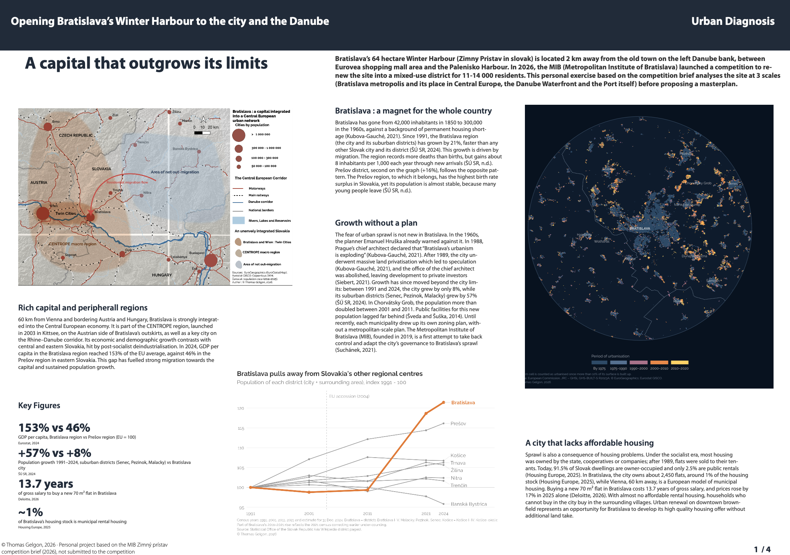

# Opening Bratislava's Winter Harbour to the City and the Danube: Urban Diagnosis

## Overview

Personal urban design exercise based on the 2026 competition brief of the Metropolitan Institute of Bratislava (MIB) to turn the 64.5 ha Winter Harbour (Zimný prístav) into a mixed-use waterfront district for 11,700 to 14,600 residents. The diagnosis analyses the site at three scales (Bratislava and its place in Central Europe, the Danube waterfront, the harbour itself) before a masterplan proposal. The project was not submitted to the competition.

**Study Area:** Zimný prístav (Winter Harbour), left bank of the Danube, Bratislava, Slovakia  
**Duration:** Autumn 2026 – ongoing  
**Role:** Solo project (personal exercise)  
**Status:** In progress (diagnosis completed, masterplan to follow)

---

## Methods & Tools

**Data Sources**

- MIB (2026), *Zimný prístav: competition brief* (site area, heritage, flood levels, programme)
- Statistical Office of the Slovak Republic (ŠÚ SR): district population 1991–2024 and demographic projections
- Eurostat (2026): GDP per capita by NUTS 3 region
- Housing Europe (2025) and Deloitte (2026): housing tenure and property prices
- Literature on Bratislava's urban planning and waterfront (Kubova-Gauché, Siebert, Šveda and Šuška, Vítková)
- Spatial data: GHS-BUILT-S (JRC), EuroGlobalMap, Eurostat GISCO, OpenStreetMap (Geofabrik), LiDAR digital terrain model DMR 6.0 (ÚGKK SR)
- Field visit: photographs and informal interviews

**Processing Steps**

1. **Metropolitan scale:** place Bratislava within Central Europe (CENTROPE, Danube corridor), compare population growth of districts since 1991, and map built-up expansion by period of urbanisation
2. **Waterfront scale:** map public space along the Danube's left bank, build a historical timeline of the city's relationship with the river, and document the waterfront on site
3. **Site scale:** map built heritage and harbour structures (including cranes digitised from imagery), and summarise the site and the brief in a site identity card
4. **Constraints and issues:** compare site levels from the LiDAR terrain model with the brief's flood levels (100-year level of 137.6 m, 139.7 m with climate margin), map barriers and noise, and synthesise four key issues from constraint to opportunity

**Tools Used**

| Tool | Purpose |
|------|---------|
| QGIS | Mapping and spatial analysis (site, heritage, flood levels) |
| Adobe Illustrator | Layout of the four diagnostic boards |
| R | Urban sprawl & Floods maps and population growth graph |

---

## Key Findings

- Bratislava's region grew by 21% between 1991 and 2024, faster than any other Slovak region, but the city itself grew by only 8% while its suburban districts (Senec, Pezinok, Malacky) grew by 57% (ŠÚ SR, 2024), a growth long unplanned at metropolitan scale
- Strong regional disparities fuel this attraction: GDP per capita reaches 153% of the EU average in the Bratislava region against 46% in the Prešov region (Eurostat, 2024)
- Housing is a driver of sprawl: the city owns about 1% of its housing stock, and a new 70 m² flat costs 13.7 years of gross salary (Housing Europe, 2025; Deloitte, 2026)
- The left bank of the Danube is open to the public but does not work as one continuous space, and the Winter Harbour is the missing link between Eurovea and the Pálenisko port
- The harbour (64.5 ha, built 1897–1901) combines protected heritage (basins, boat lift, cranes), flood-prone land, and isolation by roads and rail tracks
- Four key issues emerge for the masterplan: open the site, extend the waterfront, keep the harbour, and live with water and noise

---

## Links

[Download the diagnostic boards (PDF) :material-download:](../assets/documents/bratislava-diagnostic.pdf){ .md-button }
