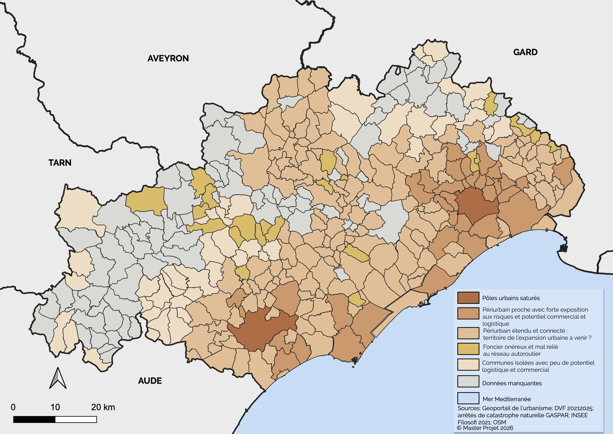

# Typology of Hérault Municipalities for Land-Use Trade-offs

*Typology of Hérault municipalities by land-use trade-offs (map legend in French).*

## Overview

Typology of the municipalities of the Hérault département most likely to host commercial and logistics activities, and therefore the areas most exposed to land artificialisation. The map crosses five variables that shape land-use trade-offs (available land, price, hazards, customer catchment area and logistics accessibility) through a principal component analysis followed by hierarchical clustering. This is my individual analysis, produced as part of a collective project for an exhibition organised with the Hérault Chamber of Commerce and Industry (CCI).

**Study Area:** Hérault département, France (256 of 341 municipalities, those with a local urban plan)  
**Duration:** Autumn 2026 – ongoing  
**Role:** Contributor (individual analysis within a group project)  
**Status:** In progress

---

## Methods & Tools

**Data Sources**

- Local urban plans (PLU), via the Géoportail de l'urbanisme: surface of urban (U) and to-be-urbanised (AU) zones
- DVF land transactions, 2021–2025: median price of business premises
- GASPAR: natural disaster decrees
- INSEE Filosofi 2021: population within an 8 km radius
- OpenStreetMap: straight-line distance to the nearest road interchange

**Processing Steps**

1. Prepare the five variables in QGIS for the 256 municipalities with a PLU; where no sales were recorded, the price of the nearest neighbouring municipality is used
2. Run a standardised Principal Component Analysis (PCA) in R, with the origin of the price (measured or imputed) as an illustrative variable to check that imputation does not bias the results; the first two axes capture 63% of the information
3. Cluster municipalities with Hierarchical Clustering on Principal Components, resulting in five groups
4. Characterise each group through the variables that distinguish it from the average, and name the groups
5. Export the results and map the typology in QGIS by joining on the INSEE municipality code

**Tools Used**

| Tool | Purpose |
|------|---------|
| QGIS | Preparation of the spatial variables and choropleth map of the typology |
| R (FactoMineR, factoextra, dplyr) | PCA, hierarchical clustering and statistical charts |

---

## Key Findings

- The first two PCA axes capture 63% of the information, and the municipalities fall into five types:
    1. **Saturated urban hubs**, mainly two poles (around Montpellier and in the south-west of the département)
    2. **Close peri-urban areas** with high hazard exposure and commercial and logistics potential
    3. **Extended, well-connected peri-urban areas**, a possible territory of future urban expansion
    4. **Expensive land, poorly connected to the motorway network**
    5. **Isolated municipalities** with little logistics and commercial potential
- Peri-urban municipalities (types 2 and 3) are the most likely candidates for future artificialisation linked to commercial and logistics activities
- The 85 municipalities without a PLU, mostly in the west and north-west, are excluded for lack of data

---

## Links

[Download the final map (PDF) :material-download:](../assets/documents/acp_finale.pdf){ .md-button }
