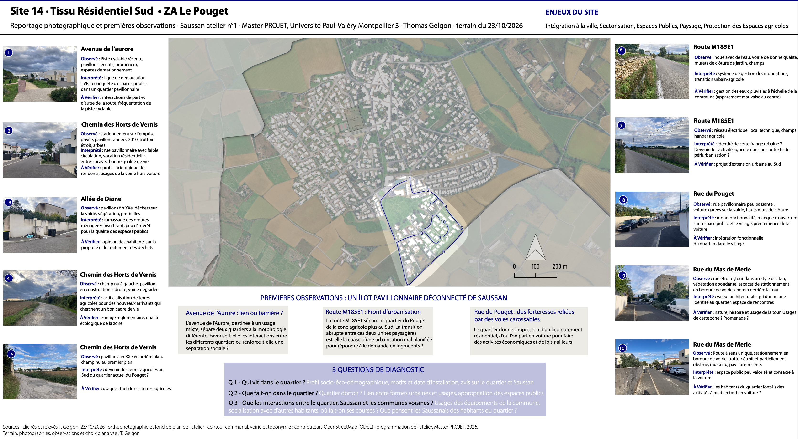

# Saussan Urban Design Studio: From a Sector Diagnosis to a Shared Plan-Guide

*Photo board from the launch-day field visit, 23 October 2026.*

## Overview

Master's urban design studio for the commune of Saussan, in which 25 students each diagnose one of 22 sectors and sketch a targeted intervention, then assemble their analyses week by week into a shared Plan-Guide: a spatial strategy for the commune to 2040. The work is presented publicly to the commune on 18 December 2026. My individual sector is Site 14, the southern residential fabric of Le Pouget, a pavilion-style district whose main issues are integration into the town, sectorisation, public spaces, landscape and the protection of agricultural land.

**Study Area:** Saussan, Hérault (Montpellier Méditerranée Métropole)  
**Duration:** October 2026 – December 2026 (public presentation on 18 December)  
**Role:** Contributor (one individual sector within a 25-student team)  
**Status:** In progress

---

## Methods & Tools

**Data Sources**

- INSEE statistical series
- Planning documents (PLU and related) and maps
- Orthophotograph and base map provided by the studio
- OpenStreetMap contributors (ODbL): commune boundary, roads and place names
- Field survey: located photographs, counts and targeted interviews

**Processing Steps**

The studio follows a protocol shared by the 22 sectors, with a common analysis grid (urban forms, housing, activities, mobility, public spaces, water and land):

1. **Data baseline:** gather and organise sources
2. **Field and survey:** photographs, counts and interviews on site
3. **Issue sheets:** verified evidence, tensions and room for action
4. **2040 scenarios:** three trajectories compared (trend continuation; increased pressure on resources and services; voluntarist transformation of centralities)
5. **Pre-programme:** spatial sketches and experimentation sheets

**Deliverables**

- Individual: an A0 diagnostic board, an A0 proposals board (prospective work and programming sketch), and a model or media (video, photomontage or physical model)
- Collective: a Plan-Guide built from a shared tracking table, a single map overlaying all proposals, and a sorting of actions between quick tests and lasting developments

**Tools Used**

| Tool | Purpose |
|------|---------|
| Field photography | Launch-day photographic survey of the commune |
| Adobe Illustrator | Layout of the photo board and site map |

---

## Progress & Next Steps

- **23 October 2026:** launch day on site. I produced a photo board for Site 14 with ten located photographs, each with what was observed, an interpretation and points to verify
- **First hypotheses:** Le Pouget reads as a pavilion-style block disconnected from the village, with Avenue de l'Aurore as either a link or a barrier between districts, the M185E1 road as an urbanisation front facing farmland, and streets largely devoted to cars
- **Three diagnostic questions:** who lives in the district, what is done there, and how it interacts with Saussan and neighbouring communes
- **November 2026:** documentary baseline, first field surveys, interim diagnosis and a prioritised map of issues
- **December 2026:** three scenarios and synthesis into the Plan-Guide, followed by a public presentation of the 22 sketches and the Plan-Guide to the commune on 18 December
- **2027 onwards:** revision following the elected officials' feedback (January 2027), then a second studio (September 2027 – February 2028)

---

## Links

[Download the Site 14 photo board (PDF) :material-download:](../assets/documents/saussan-site14-reportage.pdf){ .md-button }
